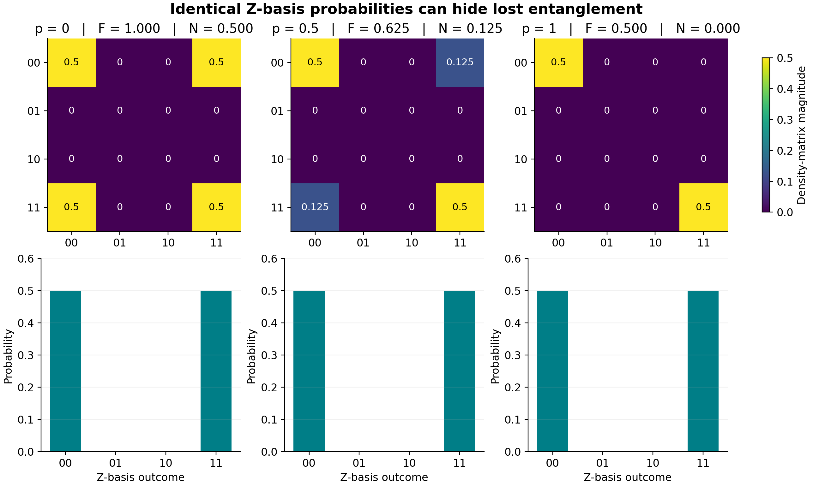

# What survives when a Bell pair becomes noisy?

Independent local noise can remove entanglement while leaving every
computational-basis probability unchanged. It can also return a state to
purity one after its entanglement has vanished. This study makes both effects
visible and checks the predictions with two numerical implementations.

## Research question and scope

Prepare the Bell state

$$
|\Phi^+\rangle = \frac{|00\rangle+|11\rangle}{\sqrt{2}},
\qquad \rho_0=|\Phi^+\rangle\langle\Phi^+|.
$$

Apply the same channel independently to each qubit:

$$
\rho(p) = (\mathcal E_p\otimes\mathcal E_p)(\rho_0),\qquad 0\le p\le1.
$$

How do fidelity, entanglement, purity, and measurement correlations change?
Can any one of them tell the whole story?

The preparation gates are ideal. Noise is applied once to each wire after
preparation, with no correlated errors, readout errors, or gate-duration model.
The basis order is `00, 01, 10, 11`, with wire 0 as the first tensor factor.
These are exact density-matrix simulations, not finite-shot or hardware data.

## Models and physical parameter conventions

The NumPy model applies local Kraus operators explicitly. The PennyLane model
uses built-in channels on `default.mixed`; it shares input validation but no
state-evolution code with NumPy.

| Channel | Meaning of this study's parameter p | PennyLane parameter |
| --- | --- | --- |
| Dephasing | Multiply each single-qubit off-diagonal entry by `1-p` | `PhaseDamping(gamma=p*(2-p))` |
| Depolarizing | Single-qubit map `(1-p)rho + p I/2` | `DepolarizingChannel(3*p/4)` |
| Amplitude damping | Excited-state decay probability p | `AmplitudeDamping(p)` |

PennyLane's phase-damping parameter scales coherence by
$\sqrt{1-\gamma}$, so matching $1-p$ requires $\gamma=1-(1-p)^2$.
Its depolarizing parameter is the total Pauli-error probability, with full
mixing at `3/4`; therefore it must be rescaled here. These conversions follow
the official [PhaseDamping](https://docs.pennylane.ai/en/stable/code/api/pennylane.PhaseDamping.html),
[DepolarizingChannel](https://docs.pennylane.ai/en/stable/code/api/pennylane.DepolarizingChannel.html),
and [AmplitudeDamping](https://docs.pennylane.ai/en/stable/code/api/pennylane.AmplitudeDamping.html)
definitions. Passing the same raw number to every SDK channel would compare
different physical models.

Equal p values across different channel families are also different physical
processes. This plot is a parameterized comparison, not a hardware-calibrated
ranking of which noise mechanism is worse.

## Observables

Fidelity uses the squared-overlap convention for a pure reference:

$$
F(p)=\langle\Phi^+|\rho(p)|\Phi^+\rangle.
$$

Purity is $P(p)=\operatorname{Tr}(\rho(p)^2)$. It measures mixedness and
does not, by itself, establish entanglement.

Entanglement is measured by negativity,

$$
\mathcal N(\rho)=\frac{\|\rho^{T_B}\|_1-1}{2}
=\sum_{\lambda_i<0}|\lambda_i|,
$$

where $\lambda_i$ are eigenvalues of the partial transpose on Bob's qubit.
This definition follows [Vidal and Werner](https://arxiv.org/abs/quant-ph/0102117).
For the two-qubit states studied here, positivity of the partial transpose is
necessary and sufficient for separability, by the
[Peres criterion](https://arxiv.org/abs/quant-ph/9604005) and the
[Horodecki result](https://arxiv.org/abs/quant-ph/9605038). A Bell pair has
$\mathcal N=1/2$; a separable two-qubit state has zero negativity. The
sufficiency statement does not extend to arbitrary higher dimensions.

We also record $\langle X\otimes X\rangle$ and
$\langle Z\otimes Z\rangle$ to distinguish phase coherence from Z-basis
correlation. These are exact expectations, with no sampling uncertainty.

## Analytical predictions

Write $s=1-p$. The formulas below are derived for this initial Bell state
and these independent local channels; they are not general formulas for
arbitrary input states.

### Dephasing

Each local channel multiplies the `00,11` coherence by s. Applying it to both
qubits therefore gives:

$$
\rho_{\mathrm{deph}}(p)=\frac12
\begin{bmatrix}
1&0&0&s^2\\
0&0&0&0\\
0&0&0&0\\
s^2&0&0&1
\end{bmatrix}.
$$

Its partial-transpose eigenvalues are $1/2,1/2,s^2/2,-s^2/2$.
The diagonal, and hence the Z-basis probabilities, is independent of p.

### Depolarizing noise

Local Pauli correlations shrink by s on each wire, yielding:

$$
\rho_{\mathrm{depol}}(p)=s^2\rho_0+(1-s^2)I_4/4.
$$

The smallest partial-transpose eigenvalue is $(1-3s^2)/4$. It becomes
nonnegative at the exact boundary:

$$
p_* = 1-\frac1{\sqrt3}\approx 0.42264973.
$$

The state is entangled for $p<p_*$ and separable for $p\ge p_*$.

### Amplitude damping

The `11` component can lose either excitation or both. Adding these decay
branches gives:

$$
\rho_{\mathrm{AD}}(p)=\frac12
\begin{bmatrix}
1+p^2&0&0&s\\
0&ps&0&0\\
0&0&ps&0\\
s&0&0&s^2
\end{bmatrix}.
$$

The potentially negative partial-transpose eigenvalue is $-s^2/2$.
At p=1 the output is the pure product state $|00\rangle$.

### Metric formulas used for independent validation

| Channel | Bell fidelity F | Negativity N | Purity P |
| --- | --- | --- | --- |
| Dephasing | $(1+s^2)/2$ | $s^2/2$ | $(1+s^4)/2$ |
| Depolarizing | $(1+3s^2)/4$ | $\max(0,(3s^2-1)/4)$ | $(1+3s^4)/4$ |
| Amplitude damping | $1-p+p^2/2$ | $s^2/2$ | $1-2p+3p^2-2p^3+p^4$ |

For dephasing, `XX=s^2` and `ZZ=1`; for depolarizing noise both equal
`s^2`; for amplitude damping `XX=s` and `ZZ=1-2p+2p^2`.

These predictions are evaluated algebraically, independently of the numerical
Kraus sums and numerical eigenvalue calculations.

## Results


Lines show NumPy predictions; open markers show PennyLane values. The dashed
orange curve represents amplitude damping. Its fidelity and negativity
coincide with dephasing in this parameterization, while its purity differs.
The vertical line marks the analytical depolarizing threshold.

At p=0.5, the two implementations reproduce these analytical values:

| Channel | Fidelity | Negativity | Purity |
| --- | --- | --- | --- |
| Dephasing | 0.625 | 0.125 | 0.53125 |
| Depolarizing | 0.4375 | 0 | 0.296875 |
| Amplitude damping | 0.625 | 0.125 | 0.5625 |

The default sweep has 101 equally spaced values from 0 to 1 for each channel.
Across both models it checks 606 density matrices. The maximum NumPy/PennyLane
entrywise difference in the committed run is approximately `2.04e-14`;
the maximum discrepancy from an analytical metric is below `4.1e-14`.
Both are well below the absolute acceptance tolerance `1e-10`, with relative
tolerance zero. Raw data retain tiny floating-point and SDK numerical
residuals rather than clipping them to physical bounds.

The sampled grid brackets the depolarizing transition between 0.42 and 0.43.
The analytical value `0.42264973` comes from the partial-transpose spectrum,
not from treating 0.43 as an exact threshold. Tests also evaluate points just
below, at, and just above the exact boundary.

### Unchanged probabilities can hide lost entanglement



Every column has `P(00)=P(11)=1/2`. At p=0 the state is maximally entangled;
at p=1 it is the separable mixture
$(|00\rangle\langle00|+|11\rangle\langle11|)/2$.
The missing off-diagonal entries explain the lost coherence.

Perfect Z-basis correlation is therefore insufficient evidence of a surviving
Bell pair. In this family, the complementary XX expectation decreases from
one to zero and reveals the change hidden from Z-basis probabilities.

### Purity can recover after entanglement is lost

Under amplitude damping, purity falls to 0.5625 at p=0.5, then returns to one
at p=1 as both qubits relax to `00`. Negativity reaches zero at that endpoint.
The returned purity describes a known product state, not a recovered
entanglement resource.

Dephasing and amplitude damping also demonstrate a subtler limitation: equal
fidelity and negativity curves do not identify the underlying physical
channel. Their density matrices, purity, and measurement correlations differ.

## Reproduction and evidence

Run from the repository root:

```bash
python -m pip install -r tools/uv-requirement.txt
uv sync --locked --extra test --extra pennylane --no-editable
uv run --no-sync python -m studies.bell_noise.run_study
uv run --no-sync python -m pytest -q tests/studies
```

The runner checks physicality, agreement with analytical states and metrics,
and cross-framework agreement before exporting results. Missing PennyLane is
an error for the default comparison. An explicit lightweight alternative is:

```bash
uv run --no-sync python -m studies.bell_noise.run_study --numpy-only --output-dir build/bell-noise-numpy
```

The NumPy-only summary records that no cross-framework comparison was done.
The deterministic density-matrix sweep needs no random seed. `--points`
changes grid resolution and `--output-dir` selects the artifact directory.

- [CSV data](../assets/bell-noise/results.csv): one row per channel, p, and model,
  including five metrics and numerical residuals.
- [Validation summary](../assets/bell-noise/summary.json): parameters, check
  counts, numerical errors, threshold bracket, Python, and package versions.
- [Metrics SVG](../assets/bell-noise/metrics.svg) and
  [coherence SVG](../assets/bell-noise/coherence.svg): scalable figure exports.

Implementation is in `studies/bell_noise/`. CI runs the NumPy study in the core
job, the full comparison in the PennyLane job, and uploads their artifacts.
The tests include Kraus completeness, agreement with the core single-qubit
channels, an asymmetric complex product-state partial transpose, the Bell
partial-transpose spectrum, and the scientific conclusions above.

## Limits and follow-up questions

This is a controlled educational simulation of known effects. It does not
claim a new noise model or a new entanglement result. It covers two qubits,
one initial state, identical local strengths, and one application of each
channel. Increasing p here is not the same experiment as increasing circuit
depth, elapsed time, or a measured hardware error rate.

Negativity is computed from the exact joint state. On hardware, estimating it
would require additional measurements and uncertainty analysis. Values below
the numerical tolerance are treated as numerically zero; exact formulas
remain the authority at separability boundaries.

Natural extensions are unequal noise strengths on the two wires, comparison
with correlated errors, time-calibrated T1/T2 models, and entanglement
certification using finite measurement samples.
