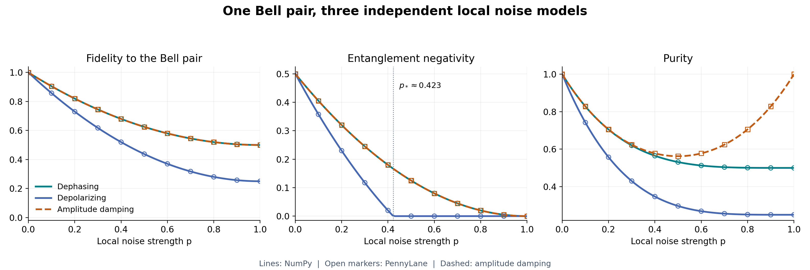

# Review Quantum-Ed in ten minutes

Quantum-Ed connects quantum theory to explicit numerical implementations and
checks that the resulting claims survive execution. This route selects the
most informative evidence for a technical reviewer. Allow about ten minutes
for reading; installation and optional SDK checks are separate.

## A short reading route

| Time | Read or inspect | What to assess |
| --- | --- | --- |
| 0-2 minutes | [Bell-noise results](07-noise-and-channels/bell-noise-study.md#results) | A concrete question, interpretable figures, and conclusions supported by numerical data |
| 2-4 minutes | [Model definitions and derivation](07-noise-and-channels/bell-noise-study.md#models-and-physical-parameter-conventions), then the study source below | Whether independent implementations use the same physical channel and match analytical predictions |
| 4-6 minutes | [Experiment validation](reference/experiment-validation.md) and the phase-sensitive tests below | Whether comparisons detect incorrect relative phases, bit reversals, and misleading measurement-only agreement |
| 6-8 minutes | [Input contracts](reference/input-contracts.md) and the NumPy core below | Short functions, explicit numerical conventions, clear rejection of invalid inputs |
| 8-10 minutes | [Scientific scope](reference/scientific-scope.md) and [hardware assumptions](08-hardware/README.md) | Precise claims, primary sources, and separation of toy models from empirical or resource estimates |



## Follow one result all the way to its evidence

**Question:** can a noisy state keep Bell-like measurement probabilities after
losing its entanglement?

The [coherence figure](assets/bell-noise/coherence.png) shows that dephasing
leaves `P(00)=P(11)=1/2` while eliminating the off-diagonal coherence and
negativity at full dephasing. The [report](07-noise-and-channels/bell-noise-study.md)
derives the state and explains the measurement limitation.

| Evidence | Where to inspect it |
| --- | --- |
| Explicit state preparation and local Kraus sums | [NumPy model](https://github.com/cicixgliamici/quantum_ed/blob/main/studies/bell_noise/numpy_model.py) |
| Independent built-in SDK channels, with parameter conversions | [PennyLane model](https://github.com/cicixgliamici/quantum_ed/blob/main/studies/bell_noise/pennylane_model.py) |
| Closed-form density matrices and metrics | [Analytical predictions](https://github.com/cicixgliamici/quantum_ed/blob/main/studies/bell_noise/theory.py) |
| Physicality, theory agreement, and framework agreement | [Sweep and export code](https://github.com/cicixgliamici/quantum_ed/blob/main/studies/bell_noise/run_study.py) |
| Measured values and environment | [CSV](assets/bell-noise/results.csv) and [JSON summary](assets/bell-noise/summary.json) |
| Channel completeness, partial transpose, and threshold checks | [Study tests](https://github.com/cicixgliamici/quantum_ed/blob/main/tests/studies/test_bell_noise.py) |

The included full run checks 606 density matrices across three channels,
101 strengths, and two models. Its maximum framework discrepancy is around
`2e-14`, below absolute tolerance `1e-10`. These numbers describe numerical
agreement for this family, not hardware performance or a new entanglement
theorem. Dephasing and amplitude damping share fidelity and negativity curves
in this example while having different purity, which provides a second
reason to inspect more than one observable.

## Inspect the engineering choices

The [core state utilities](https://github.com/cicixgliamici/quantum_ed/blob/main/src/quantum_ed/states.py)
and [shared validation](https://github.com/cicixgliamici/quantum_ed/blob/main/src/quantum_ed/_validation.py)
keep tensor shapes, finite-value checks, and normalization policy visible.
The [input-contract tests](https://github.com/cicixgliamici/quantum_ed/blob/main/tests/test_input_contracts.py)
cover invalid dimensions, nonphysical matrices, and extreme finite amplitudes.

The [equivalence tests](https://github.com/cicixgliamici/quantum_ed/blob/main/tests/experiments/test_equivalence.py)
inspect QFT amplitudes rather than uniform probabilities alone, and compare
Bob's reduced density matrix for seven teleportation inputs. They also feed
incorrect relative phases, reversed bits, and biased counts to the checks.
The [SDK validator](https://github.com/cicixgliamici/quantum_ed/blob/main/tools/validate_experiments.py)
runs Q# and imported OpenQASM entrypoints as well as checking the Python models.

Scientific notes have their own
[executable examples and counterexamples](https://github.com/cicixgliamici/quantum_ed/blob/main/tests/test_documentation_examples.py).
These include the difference between pure/pure and pure/mixed fidelity
identities, correct Y-basis measurement, and a routed CNOT checked as a full
unitary. The source-link validator checks links into this repository against
the local checkout.

## Reproduce independently

For a network-protocol example, inspect
[entanglement swapping](11-quantum-networks/entanglement-swapping.md).
The four-branch derivation is checked in all five ecosystems, including phase
corrections and branch probabilities. The corresponding notebook contrasts
the conditional Bell states with the ensemble obtained without Bob's record.

Run commands from the repository root using Python 3.11 or newer. A virtual
environment is recommended. Start with the lightweight core:

```bash
python -m pip install -r tools/uv-requirement.txt
uv sync --locked --extra test --no-editable
uv run --no-sync python tools/verify_repository.py
uv run --no-sync python -m pytest -q
uv run --no-sync python demos/bell_cli.py
```

The lockfile fixes transitive versions as well as direct dependencies. The
reference interpreter is CPython 3.14.3; the core CI matrix covers Python
3.11-3.14 on Linux and Windows. Core installation skips tests for optional SDKs
that are absent. See [environment reproduction](reference/reproducibility.md). To reproduce
the five-ecosystem checks and the complete study:

```bash
uv sync --locked --all-extras --no-editable
uv run --no-sync python tools/validate_experiments.py --ecosystem numpy qiskit pennylane openqasm qsharp
uv run --no-sync python -m studies.bell_noise.run_study --output-dir build/bell-noise-review
uv run --no-sync python -m pytest -q
```

The new output directory contains the CSV, environment/validation summary,
and PNG/SVG figures. Parameters and package versions are recorded so numerical
agreement can be assessed explicitly, rather than requiring identical image
bytes across different library versions.

For notebook exploration, follow the
[executed notebook lessons](notebooks.md). The [project design](project-design.md)
explains the contribution, tradeoffs, and conventions behind the implementation.
The [quality workflow](https://github.com/cicixgliamici/quantum_ed/blob/main/.github/workflows/quality.yml)
specifies core tests, separate SDK jobs, study reproduction, notebook execution,
and strict documentation builds. CI artifacts retain the generated study data
and figures for inspection.

## Boundaries of the project

The contribution is a readable, testable educational implementation and a
controlled reproduction of known results. The algorithms use small simulated
instances. Static VQE examples prepare a selected ansatz, while the Python
versions include optimization. The noise study uses one Bell input and
independent identical local channels, not measured hardware calibration.

Agreement on these examples is evidence for their stated behavior, not proof
of arbitrary program equivalence or a quantum speedup. Potential extensions
are unequal or correlated noise and finite-shot entanglement certification.
